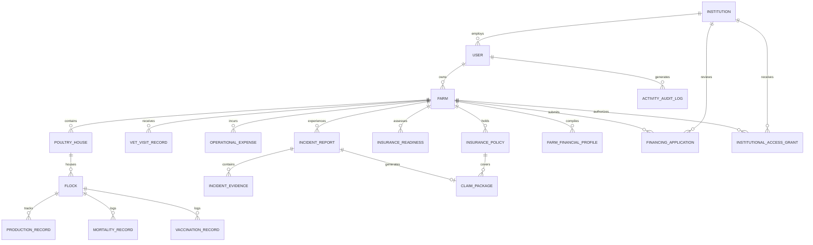

# SHARED DATABASE SCHEMA SPECIFICATION
**Project**: Commercial Poultry Insurance & Finance Infrastructure (Jari)  
**Target Market**: Jos South LGA, Plateau State, Nigeria  
**Hackathon**: HackJos 2026 | Track: Agri-Finance / Farmer Inclusion  
**Document Status**: APPROVED SPECIFICATION (V1.0)

---

## 1. ARCHITECTURAL DATA PRINCIPLES

1. **Relational Integrity**: Strict foreign-key constraints between core agricultural operational tables and higher-order financial/insurance instruments.
2. **Deterministic Ownership**:
   - **Japhet (Workstream 1)**: Owns Operational, Agricultural, Veterinary, Mortality, Incident, and Insurance Policy/Claim data ingestion and verification models.
   - **Developer 2 (Workstream 2)**: Owns Financial Profiles, Financing Applications, Institutional Portfolios, Access Grants, and Audit Trails.
   - **Shared**: Authentication, Core User, Institution Master, and Media/Document attachments.
3. **Auditability & Regulatory Compliance**: In compliance with NAICOM insurtech operational guidelines and NDPR data privacy standards, all financial and operational evidence documents must be immutable and timestamped.
4. **Idempotent Identifiers**: All reference codes (Flock Code, Incident Number, Claim Reference, Application Code) must use human-readable prefixed sequences (e.g., `FLK-2026-001`, `INC-2026-001`, `CLM-2026-001`, `LOAN-2026-001`).

---

## 2. ENTITY RELATIONSHIP OVERVIEW

---

## 3. CORE ENTITY SPECIFICATIONS

### 3.1 Identity & Master Entities (Shared)

#### `institutions`
Represents insurance underwriters, lending banks, microfinance institutions, and regulatory bodies.
*Note: Institutions in the MVP are prospective pilot entities.*

| Column | Type | Nullable | Description / Constraints |
| :--- | :--- | :--- | :--- |
| `id` | UUID / TEXT | NO | Primary Key |
| `name` | VARCHAR(150) | NO | Legal Name (e.g., "Nigerian Agricultural Insurance Corporation (NAIC)", "Gowans Microfinance Bank", "Leadway Assurance") |
| `type` | ENUM / TEXT | NO | `INSURANCE_UNDERWRITER`, `COMMERCIAL_BANK`, `MICROFINANCE_BANK`, `DEVELOPMENT_FINANCE`, `REGULATOR` |
| `registration_code` | VARCHAR(50) | YES | CAC/RC Number or CBN/NAICOM license identifier |
| `contact_email` | VARCHAR(120) | NO | Institutional contact |
| `contact_phone` | VARCHAR(25) | NO | Nigerian telephone (+234...) |
| `address` | TEXT | YES | Physical office address (e.g., Jos Branch, Plateau State) |
| `is_verified` | BOOLEAN | NO | Default: `true` (for demo/pilot institutions) |
| `created_at` | TIMESTAMP | NO | Default: `CURRENT_TIMESTAMP` |
| `updated_at` | TIMESTAMP | NO | Default: `CURRENT_TIMESTAMP` |

#### `users`
System accounts across farmers, agricultural officers, vets, and institutional analysts.

| Column | Type | Nullable | Description / Constraints |
| :--- | :--- | :--- | :--- |
| `id` | UUID / TEXT | NO | Primary Key |
| `institution_id` | UUID / TEXT | YES | Foreign Key -> `institutions.id` (NULL for independent farmers) |
| `email` | VARCHAR(150) | NO | Unique email address |
| `phone_number` | VARCHAR(25) | NO | Unique mobile phone (+234 format) |
| `password_hash` | VARCHAR(255) | NO | Bcrypt / Argon2 hash |
| `full_name` | VARCHAR(150) | NO | Given and surname |
| `role` | ENUM / TEXT | NO | `FARMER`, `VET_OFFICER`, `INSURER_OFFICER`, `LENDER_OFFICER`, `ADMIN` |
| `is_active` | BOOLEAN | NO | Default: `true` |
| `created_at` | TIMESTAMP | NO | Default: `CURRENT_TIMESTAMP` |
| `updated_at` | TIMESTAMP | NO | Default: `CURRENT_TIMESTAMP` |

---

### 3.2 Farm Management & Operational Records (Owned by Japhet)

#### `farms`
Commercial poultry farm entities. Target segment: commercial scale (initially 2,000+ birds) in Jos South LGA.

| Column | Type | Nullable | Description / Constraints |
| :--- | :--- | :--- | :--- |
| `id` | UUID / TEXT | NO | Primary Key |
| `farmer_id` | UUID / TEXT | NO | Foreign Key -> `users.id` (Owner) |
| `farm_name` | VARCHAR(150) | NO | Registered or operational business name |
| `registration_number` | VARCHAR(60) | YES | CAC Business Name / Cooperatives reg |
| `state` | VARCHAR(50) | NO | Default: "Plateau State" |
| `lga` | VARCHAR(50) | NO | Default: "Jos South" (e.g., Bukuru, Gyel, Kuru, Du, Vwang) |
| `community_address` | TEXT | NO | Detailed physical address / landmark |
| `gps_latitude` | DECIMAL(10,8) | YES | Geo-verification coordinate (e.g., 9.7999) |
| `gps_longitude` | DECIMAL(11,8) | YES | Geo-verification coordinate (e.g., 8.8787) |
| `total_capacity_birds` | INTEGER | NO | Total bird holding capacity across all houses |
| `biosecurity_level` | ENUM / TEXT | NO | `BASIC`, `STANDARD`, `ADVANCED` |
| `water_source` | VARCHAR(80) | NO | `BOREHOLE`, `WELL`, `MUNICIPAL`, `STREAM` |
| `power_backup` | VARCHAR(80) | NO | `SOLAR_INVERTER`, `GENERATOR`, `GRID_ONLY`, `HYBRID` |
| `veterinarian_assigned` | VARCHAR(150) | YES | Name/VCN of retained veterinary surgeon |
| `established_year` | INTEGER | NO | Year operations commenced |
| `created_at` | TIMESTAMP | NO | Default: `CURRENT_TIMESTAMP` |
| `updated_at` | TIMESTAMP | NO | Default: `CURRENT_TIMESTAMP` |

#### `poultry_houses`
Individual physical pens or housing structures on the farm.

| Column | Type | Nullable | Description / Constraints |
| :--- | :--- | :--- | :--- |
| `id` | UUID / TEXT | NO | Primary Key |
| `farm_id` | UUID / TEXT | NO | Foreign Key -> `farms.id` ON DELETE CASCADE |
| `house_number` | VARCHAR(50) | NO | Identifier (e.g., "Pen House 1", "Brooder A") |
| `housing_type` | ENUM / TEXT | NO | `DEEP_LITTER`, `BATTERY_CAGE`, `SEMI_INTENSIVE` |
| `capacity_birds` | INTEGER | NO | Design capacity for birds |
| `length_meters` | DECIMAL(6,2) | YES | Physical dimension |
| `width_meters` | DECIMAL(6,2) | YES | Physical dimension |
| `ventilation_system` | VARCHAR(60) | NO | `NATURAL_CROSS_VENTILATION`, `TUNNEL_EXTRACTOR_FANS`, `EVAPORATIVE_PADS` |
| `status` | ENUM / TEXT | NO | `ACTIVE`, `CLEANING_DISINFECTION`, `EMPTY_RESTING`, `QUARANTINED` |
| `created_at` | TIMESTAMP | NO | Default: `CURRENT_TIMESTAMP` |

#### `flocks`
Production batches of birds housed in a specific poultry house.

| Column | Type | Nullable | Description / Constraints |
| :--- | :--- | :--- | :--- |
| `id` | UUID / TEXT | NO | Primary Key |
| `farm_id` | UUID / TEXT | NO | Foreign Key -> `farms.id` |
| `poultry_house_id` | UUID / TEXT | NO | Foreign Key -> `poultry_houses.id` |
| `flock_code` | VARCHAR(50) | NO | Unique batch code (e.g., `FLK-2026-001`) |
| `bird_type` | ENUM / TEXT | NO | `LAYER`, `BROILER`, `PULLET`, `BREEDER`, `COCKEREL` |
| `breed` | VARCHAR(80) | NO | Breed (e.g., "Isa Brown", "Lohmann Brown", "Cobb 500", "Ross 308") |
| `initial_count` | INTEGER | NO | Count of day-old-chicks / birds stocked |
| `current_count` | INTEGER | NO | Current live count (reconciled by mortalities/culls) |
| `hatch_date` | DATE | NO | Hatch date |
| `stocked_date` | DATE | NO | Date received on farm |
| `hatchery_source` | VARCHAR(120) | NO | Certified hatchery vendor (e.g., Chi Farms, Zartech, Amo) |
| `expected_cycle_end` | DATE | YES | Projected slaughter or lay termination date |
| `status` | ENUM / TEXT | NO | `BROODING`, `GROWING`, `LAYING`, `DEPLETED`, `CULLED_DISEASE` |
| `created_at` | TIMESTAMP | NO | Default: `CURRENT_TIMESTAMP` |
| `updated_at` | TIMESTAMP | NO | Default: `CURRENT_TIMESTAMP` |

#### `mortality_records`
Daily mortality and depopulation log per flock. Critical for insurance claims and loss ratios.

| Column | Type | Nullable | Description / Constraints |
| :--- | :--- | :--- | :--- |
| `id` | UUID / TEXT | NO | Primary Key |
| `flock_id` | UUID / TEXT | NO | Foreign Key -> `flocks.id` ON DELETE CASCADE |
| `record_date` | DATE | NO | Date of death |
| `mortality_count` | INTEGER | NO | Number of dead birds |
| `cull_count` | INTEGER | NO | Default: 0 (moribund or sick birds culled) |
| `suspected_cause` | VARCHAR(120) | NO | Clinical suspicion (e.g., "Newcastle Disease", "Coccidiosis", "Heat Stroke", "Unknown") |
| `symptoms_observed` | TEXT | YES | Clinical signs (greenish diarrhea, respiratory rales, drop in egg production) |
| `disposal_method` | ENUM / TEXT | NO | `DEEP_BURIAL_WITH_LIME`, `INCINERATION`, `CARCASS_PIT` |
| `vet_notified` | BOOLEAN | NO | Default: `false` |
| `recorded_by_user_id` | UUID / TEXT | NO | Foreign Key -> `users.id` |
| `created_at` | TIMESTAMP | NO | Default: `CURRENT_TIMESTAMP` |

#### `production_records`
Daily egg production, weight samples, and feed consumption.

| Column | Type | Nullable | Description / Constraints |
| :--- | :--- | :--- | :--- |
| `id` | UUID / TEXT | NO | Primary Key |
| `flock_id` | UUID / TEXT | NO | Foreign Key -> `flocks.id` ON DELETE CASCADE |
| `record_date` | DATE | NO | Date recorded |
| `good_eggs_count` | INTEGER | YES | Whole clean eggs collected |
| `damaged_eggs_count`| INTEGER | YES | Cracked, soft-shelled or dirty eggs |
| `feed_consumed_kg` | DECIMAL(8,2) | YES | Kilograms fed that day |
| `water_consumed_liters` | DECIMAL(8,2) | YES | Liters consumed |
| `avg_bird_weight_grams` | DECIMAL(8,2) | YES | Sample weight (critical for broiler FCR) |
| `recorded_by_user_id` | UUID / TEXT | NO | Foreign Key -> `users.id` |
| `created_at` | TIMESTAMP | NO | Default: `CURRENT_TIMESTAMP` |

#### `vaccination_records`
Biosecurity and preventative healthcare compliance records.

| Column | Type | Nullable | Description / Constraints |
| :--- | :--- | :--- | :--- |
| `id` | UUID / TEXT | NO | Primary Key |
| `flock_id` | UUID / TEXT | NO | Foreign Key -> `flocks.id` ON DELETE CASCADE |
| `disease_target` | VARCHAR(100) | NO | E.g., `NEWCASTLE_NDV`, `INFECTIOUS_BURSAL_GUMBORO`, `MAREKS`, `FOWL_POX`, `EGG_DROP_SYNDROME` |
| `vaccine_name` | VARCHAR(120) | NO | Commercial name (e.g., "Lasota", "Clone 30", "Gumboro IBD Plus") |
| `batch_number` | VARCHAR(80) | NO | Manufacturer batch/lot number |
| `expiry_date` | DATE | NO | Vaccine vial expiry |
| `scheduled_age_days` | INTEGER | NO | Target bird age (e.g., Day 7, Day 14, Day 21) |
| `administered_date` | DATE | NO | Actual administration date |
| `route` | ENUM / TEXT | NO | `DRINKING_WATER`, `OCULAR_EYE_DROP`, `SUBCUTANEOUS_INJECTION`, `WING_WEB` |
| `administered_by` | VARCHAR(120) | NO | Name of technician/farm personnel |
| `vet_verified` | BOOLEAN | NO | Default: `false` |
| `vet_notes` | TEXT | YES | Observations |
| `created_at` | TIMESTAMP | NO | Default: `CURRENT_TIMESTAMP` |

#### `veterinary_visits`
Professional clinical inspections, post-mortem assessments, and lab tests.

| Column | Type | Nullable | Description / Constraints |
| :--- | :--- | :--- | :--- |
| `id` | UUID / TEXT | NO | Primary Key |
| `farm_id` | UUID / TEXT | NO | Foreign Key -> `farms.id` |
| `flock_id` | UUID / TEXT | YES | Foreign Key -> `flocks.id` (NULL if farm-wide biosecurity inspection) |
| `visit_date` | DATE | NO | Date of inspection |
| `veterinarian_name` | VARCHAR(150) | NO | Registered Veterinarian |
| `vcn_number` | VARCHAR(50) | NO | Veterinary Council of Nigeria Reg Number |
| `clinical_diagnosis`| TEXT | NO | Findings & differential diagnosis |
| `prescriptions` | TEXT | YES | Medications prescribed |
| `post_mortem_conducted`| BOOLEAN | NO | Default: `false` |
| `laboratory_samples_taken`| BOOLEAN | NO | Default: `false` (e.g., NVRI Vom sample submissions) |
| `report_document_url` | TEXT | YES | Signed inspection report / lab result PDF |
| `created_at` | TIMESTAMP | NO | Default: `CURRENT_TIMESTAMP` |

#### `operational_expenses`
Financial expenditures on feed, medication, and farm operations.

| Column | Type | Nullable | Description / Constraints |
| :--- | :--- | :--- | :--- |
| `id` | UUID / TEXT | NO | Primary Key |
| `farm_id` | UUID / TEXT | NO | Foreign Key -> `farms.id` |
| `flock_id` | UUID / TEXT | YES | Foreign Key -> `flocks.id` (if batch-specific) |
| `expense_date` | DATE | NO | Date incurred |
| `category` | ENUM / TEXT | NO | `FEED`, `MEDICATION_VACCINES`, `DISINFECTANTS_BIOSECURITY`, `CHICKS_PURCHASE`, `LABOR`, `FUEL_ENERGY`, `EQUIPMENT` |
| `item_description` | VARCHAR(200) | NO | Description (e.g., "20 bags Layers TopFeeds Mash", "5L Virkon S") |
| `quantity` | DECIMAL(10,2) | NO | E.g., 20.0 |
| `unit` | VARCHAR(50) | NO | `BAGS_25KG`, `LITERS`, `VIALS`, `HOURS` |
| `unit_price_ngn` | DECIMAL(12,2) | NO | Price per unit in Naira |
| `total_amount_ngn`| DECIMAL(14,2) | NO | Total expenditure in Naira |
| `vendor_name` | VARCHAR(120) | YES | Feed distributor / supplier |
| `receipt_url` | TEXT | YES | Receipt image/document link |
| `created_at` | TIMESTAMP | NO | Default: `CURRENT_TIMESTAMP` |

---

### 3.3 Insurance Readiness, Policies & Incident Claims (Owned by Japhet)

#### `insurance_readiness_assessments`
Automated readiness engine calculating an underwriting readiness score based on operational data integrity.

| Column | Type | Nullable | Description / Constraints |
| :--- | :--- | :--- | :--- |
| `id` | UUID / TEXT | NO | Primary Key |
| `farm_id` | UUID / TEXT | NO | Foreign Key -> `farms.id` ON DELETE CASCADE |
| `readiness_score` | INTEGER | NO | Composite 0 - 100 score |
| `biosecurity_compliant` | BOOLEAN | NO | Checked: foot baths, fencing, disinfection logs |
| `mortality_log_current` | BOOLEAN | NO | Checked: zero gaps in last 30 days |
| `vaccination_compliant` | BOOLEAN | NO | Checked: standard schedule adherence |
| `vet_retainer_verified` | BOOLEAN | NO | Checked: registered VCN vet attached |
| `missing_items_json` | TEXT / JSON | NO | List of outstanding criteria (e.g., `["Upload CAC Certificate", "Record Day 21 Gumboro"]`) |
| `status` | ENUM / TEXT | NO | `NOT_READY`, `PARTIALLY_READY`, `INSURANCE_READY` |
| `assessed_at` | TIMESTAMP | NO | Default: `CURRENT_TIMESTAMP` |

#### `insurance_policies`
Policy documentation linking a farm to a participating underwriter.

| Column | Type | Nullable | Description / Constraints |
| :--- | :--- | :--- | :--- |
| `id` | UUID / TEXT | NO | Primary Key |
| `farm_id` | UUID / TEXT | NO | Foreign Key -> `farms.id` |
| `institution_id` | UUID / TEXT | NO | Foreign Key -> `institutions.id` (e.g., NAIC, AIICO) |
| `policy_number` | VARCHAR(80) | NO | Underwriter policy code |
| `policy_type` | ENUM / TEXT | NO | `POULTRY_MORTALITY_STANDARD`, `COMPREHENSIVE_AVIAN_EPIDEMIC`, `FIRE_AND_EXTENDED_PERILS` |
| `sum_insured_ngn` | DECIMAL(14,2) | NO | Total maximum coverage |
| `premium_amount_ngn`| DECIMAL(14,2) | NO | Annual / cycle premium in Naira |
| `covered_flock_ids`| TEXT / JSON | YES | Array of covered `flock.id`s |
| `start_date` | DATE | NO | Inception date |
| `end_date` | DATE | NO | Expiry date |
| `policy_document_url`| TEXT | YES | PDF copy of policy schedule |
| `status` | ENUM / TEXT | NO | `PENDING_UNDERWRITING`, `ACTIVE`, `RENEWAL_DUE`, `EXPIRED`, `CANCELLED` |
| `created_at` | TIMESTAMP | NO | Default: `CURRENT_TIMESTAMP` |
| `updated_at` | TIMESTAMP | NO | Default: `CURRENT_TIMESTAMP` |

#### `incident_reports`
Initial rapid notification of disease outbreak, environmental disaster, or mortality surge.

| Column | Type | Nullable | Description / Constraints |
| :--- | :--- | :--- | :--- |
| `id` | UUID / TEXT | NO | Primary Key |
| `farm_id` | UUID / TEXT | NO | Foreign Key -> `farms.id` |
| `flock_id` | UUID / TEXT | NO | Foreign Key -> `flocks.id` |
| `incident_code` | VARCHAR(50) | NO | Unique reference (e.g., `INC-2026-004`) |
| `incident_date` | DATE | NO | Date disaster/outbreak began |
| `discovery_time` | TIME | YES | Time of detection |
| `incident_type` | ENUM / TEXT | NO | `DISEASE_OUTBREAK`, `HEAT_STRESS_MASS_MORTALITY`, `FLOODING`, `FIRE`, `CONTAMINATED_FEED`, `BURGLARY` |
| `birds_affected` | INTEGER | NO | Estimated number displaying acute morbidity |
| `birds_dead` | INTEGER | NO | Documented mortality count related to incident |
| `suspected_cause` | VARCHAR(150) | NO | Initial field observation |
| `narrative` | TEXT | NO | Comprehensive incident summary |
| `immediate_actions`| TEXT | YES | Isolation, antibiotic therapy, biosecurity lockdown |
| `status` | ENUM / TEXT | NO | `REPORTED`, `UNDER_VET_INVESTIGATION`, `EVIDENCE_COMPILING`, `CLAIM_SUBMITTED`, `CLOSED` |
| `created_at` | TIMESTAMP | NO | Default: `CURRENT_TIMESTAMP` |
| `updated_at` | TIMESTAMP | NO | Default: `CURRENT_TIMESTAMP` |

#### `incident_evidence`
Multimedia and veterinary documentation supporting an incident report.

| Column | Type | Nullable | Description / Constraints |
| :--- | :--- | :--- | :--- |
| `id` | UUID / TEXT | NO | Primary Key |
| `incident_id` | UUID / TEXT | NO | Foreign Key -> `incident_reports.id` ON DELETE CASCADE |
| `evidence_type` | ENUM / TEXT | NO | `POST_MORTEM_PHOTO`, `CARCASS_DISPOSAL_PHOTO`, `LAB_REPORT_NVRI`, `SIGNED_VET_ATTESTATION`, `SECURITY_REPORT` |
| `file_name` | VARCHAR(255) | NO | Original file name |
| `file_url` | TEXT | NO | Storage link |
| `mime_type` | VARCHAR(80) | NO | E.g., `image/jpeg`, `application/pdf` |
| `file_size_bytes` | INTEGER | NO | Size |
| `caption` | TEXT | YES | Explanatory note |
| `uploaded_by_user_id`| UUID / TEXT| NO | Foreign Key -> `users.id` |
| `uploaded_at` | TIMESTAMP | NO | Default: `CURRENT_TIMESTAMP` |

#### `claim_packages`
Assembled, structured documentation bundle presented to the insurance underwriter.

| Column | Type | Nullable | Description / Constraints |
| :--- | :--- | :--- | :--- |
| `id` | UUID / TEXT | NO | Primary Key |
| `incident_id` | UUID / TEXT | NO | Unique Foreign Key -> `incident_reports.id` |
| `insurance_policy_id`| UUID / TEXT| NO | Foreign Key -> `insurance_policies.id` |
| `institution_id` | UUID / TEXT | NO | Foreign Key -> `institutions.id` (Assigned Insurer) |
| `claim_number` | VARCHAR(50) | NO | Formatted reference (e.g., `CLM-2026-001`) |
| `claimed_amount_ngn`| DECIMAL(14,2) | NO | Compensation requested by farmer |
| `evidence_package_json`| TEXT / JSON | NO | Manifest snapshot of linked flock records, mortality logs, vaccine logs, photos & vet reports |
| `compiled_at` | TIMESTAMP | NO | Timestamp package was frozen |
| `submission_status` | ENUM / TEXT | NO | `DRAFT`, `SUBMITTED`, `UNDER_REVIEW`, `INSPECTION_REQUESTED`, `ADDITIONAL_INFO_REQUIRED`, `SETTLED`, `REPUDIATED` |
| `insurer_feedback` | TEXT | YES | Institutional adjustor commentary |
| `settled_amount_ngn`| DECIMAL(14,2) | YES | Final payout agreed by underwriter (if approved) |
| `updated_at` | TIMESTAMP | NO | Default: `CURRENT_TIMESTAMP` |

---

### 3.4 Finance Readiness, Applications & Institutional Portfolios (Owned by Developer 2)

#### `farm_financial_profiles`
Consolidated financial health metrics aggregated from operational logs and farmer declarations.

| Column | Type | Nullable | Description / Constraints |
| :--- | :--- | :--- | :--- |
| `id` | UUID / TEXT | NO | Primary Key |
| `farm_id` | UUID / TEXT | NO | Foreign Key -> `farms.id` ON DELETE CASCADE |
| `evaluation_year` | INTEGER | NO | E.g., 2026 |
| `annual_turnover_ngn`| DECIMAL(14,2) | NO | Total annual gross revenue |
| `estimated_flock_asset_value_ngn` | DECIMAL(14,2) | NO | Current live bird asset value based on market price |
| `fixed_infrastructure_value_ngn` | DECIMAL(14,2) | NO | Value of pens, cages, generators, boreholes |
| `average_monthly_feed_cost_ngn` | DECIMAL(14,2) | NO | Derived from `operational_expenses` |
| `average_monthly_net_margin_ngn` | DECIMAL(14,2) | NO | Operating cash surplus |
| `historical_mortality_rate_percent`| DECIMAL(5,2) | NO | Derived average flock mortality (vital lender risk metric) |
| `finance_readiness_score` | INTEGER | NO | 0 - 100 benchmark score |
| `readiness_level` | ENUM / TEXT | NO | `LOW_READINESS`, `EMERGING`, `FINANCE_READY`, `INVESTMENT_GRADE` |
| `compiled_at` | TIMESTAMP | NO | Default: `CURRENT_TIMESTAMP` |
| `updated_at` | TIMESTAMP | NO | Default: `CURRENT_TIMESTAMP` |

#### `financing_applications`
Credit/loan requests prepared for agricultural lenders (e.g., Gowans MFB, BOA, NMFB).

| Column | Type | Nullable | Description / Constraints |
| :--- | :--- | :--- | :--- |
| `id` | UUID / TEXT | NO | Primary Key |
| `farm_id` | UUID / TEXT | NO | Foreign Key -> `farms.id` |
| `institution_id` | UUID / TEXT | NO | Foreign Key -> `institutions.id` (Target Lending Bank) |
| `application_code`| VARCHAR(50) | NO | Formatted reference (e.g., `FIN-2026-002`) |
| `requested_amount_ngn`| DECIMAL(14,2) | NO | Principal requested |
| `loan_purpose` | ENUM / TEXT | NO | `FLOCK_RESTOCKING`, `FEED_INVENTORY_BULK`, `HOUSING_AUTOMATION`, `SOLAR_COLD_CHAIN`, `DISEASE_RECOVERY` |
| `proposed_tenor_months`| INTEGER | NO | Repayment duration (e.g., 6, 12, 24 months) |
| `repayment_cycle`| ENUM / TEXT | NO | `MONTHLY`, `BULLET_POST_HARVEST`, `QUARTERLY` |
| `attached_profile_id`| UUID / TEXT | NO | Foreign Key -> `farm_financial_profiles.id` |
| `has_active_insurance`| BOOLEAN | NO | Lender risk de-risking indicator |
| `insurance_policy_id`| UUID / TEXT | YES | Foreign Key -> `insurance_policies.id` (if de-risked) |
| `status` | ENUM / TEXT | NO | `DRAFT`, `SUBMITTED`, `UNDER_CREDIT_REVIEW`, `SITE_INSPECTION_SCHEDULED`, `APPROVED_OFFERED`, `REJECTED`, `DISBURSED` |
| `lender_internal_notes`| TEXT | YES | Loan officer feedback |
| `submitted_at` | TIMESTAMP | YES | Formal transmission timestamp |
| `created_at` | TIMESTAMP | NO | Default: `CURRENT_TIMESTAMP` |
| `updated_at` | TIMESTAMP | NO | Default: `CURRENT_TIMESTAMP` |

#### `institutional_access_grants`
Explicit consent-based data access control granting an insurer or lender visibility into specific farm modules.

| Column | Type | Nullable | Description / Constraints |
| :--- | :--- | :--- | :--- |
| `id` | UUID / TEXT | NO | Primary Key |
| `farm_id` | UUID / TEXT | NO | Foreign Key -> `farms.id` |
| `institution_id` | UUID / TEXT | NO | Foreign Key -> `institutions.id` |
| `granted_by_user_id`| UUID / TEXT | NO | Foreign Key -> `users.id` (Farm Owner) |
| `scope` | ENUM / TEXT | NO | `INSURANCE_UNDERWRITING`, `CLAIM_EVIDENCE_ACCESS`, `LOAN_ASSESSMENT`, `POST_DISBURSEMENT_MONITORING` |
| `can_view_financials`| BOOLEAN | NO | Insurer does NOT see bank details by default |
| `can_view_operational_logs`| BOOLEAN | NO | Visibility into flock, mortality, vaccine history |
| `expires_at` | TIMESTAMP | NO | Expiration timestamp (e.g., 90 days) |
| `is_revoked` | BOOLEAN | NO | Farmer can revoke access anytime |
| `created_at` | TIMESTAMP | NO | Default: `CURRENT_TIMESTAMP` |

#### `activity_audit_logs`
Immutable compliance log recording institutional document reviews and farmer data submissions.

| Column | Type | Nullable | Description / Constraints |
| :--- | :--- | :--- | :--- |
| `id` | UUID / TEXT | NO | Primary Key |
| `user_id` | UUID / TEXT | NO | Foreign Key -> `users.id` |
| `institution_id` | UUID / TEXT | YES | Foreign Key -> `institutions.id` |
| `farm_id` | UUID / TEXT | YES | Target farm accessed |
| `action` | VARCHAR(100) | NO | E.g., `VIEW_CLAIM_DOSSIER`, `SUBMIT_LOAN_APP`, `VERIFY_VACCINE_LOG` |
| `target_entity` | VARCHAR(60) | NO | E.g., `claim_packages`, `farms` |
| `target_id` | VARCHAR(100) | NO | Record ID queried |
| `ip_address` | VARCHAR(45) | YES | Request origin |
| `metadata_json` | TEXT / JSON | YES | Event details (filters, changes) |
| `created_at` | TIMESTAMP | NO | Default: `CURRENT_TIMESTAMP` |

---

## 4. DATABASE INITIALIZATION & SEED MAPPING

For the HackJos 2026 prototype, the system is designed to run seamlessly on SQLite (or PostgreSQL in production). 

Demo Seed Profile for Jos South:
- **Farm**: *Grace Heights Integrated Poultry Farms*, Gyel District, Jos South.
- **Flock 1**: 3,500 Isa Brown Layers (Day 114, active lay).
- **Flock 2**: 2,000 Cobb 500 Broilers (Day 28).
- **Simulated Insurer**: *Nigerian Agricultural Insurance Corporation (NAIC)* (Prospective Pilot).
- **Simulated Lender**: *Gowans Microfinance Bank* (Prospective Local Pilot).
- **Simulated Incident**: *Gumboro / Heat Exertion Outbreak* on House 2 with full mortality logs, NVRI Vom lab receipt, and generated claim package.

