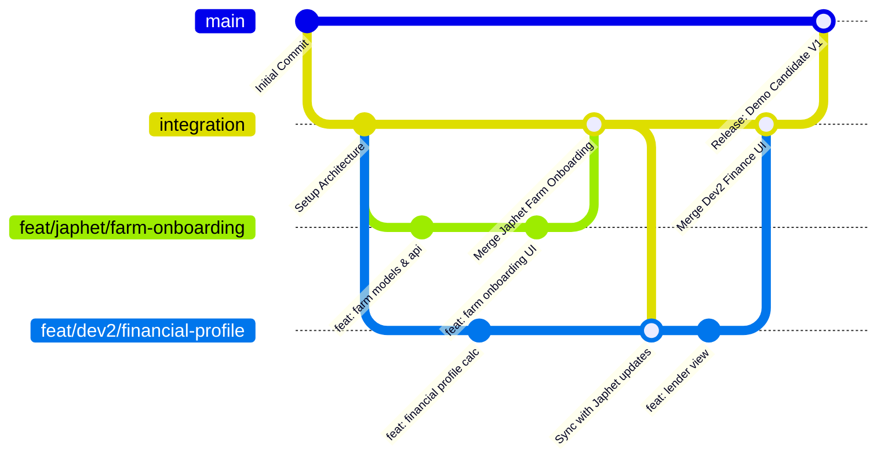

# INTEGRATION RULES & GIT COLLABORATION PROTOCOL
**Project**: Commercial Poultry Insurance & Finance Infrastructure (Jari)  
**Hackathon**: HackJos 2026 (48-Hour Deadline)  
**Status**: ACTIVE COLLABORATION PROTOCOL (V1.0)

---

## 1. CORE COLLABORATION PRINCIPLES

1. **One Integrated Application**: We are building a single unified codebase, not two disparate apps. Both developers contribute to the same architectural tree.
2. **Deterministic Module Boundaries**:
   - **Japhet**: Farm Management, Flock Cycles, Daily Mortality/Production, Vaccination Records, Expenses, Insurance Readiness, and Incident Claims Dossiers.
   - **Developer 2**: Financial Profiles, Financing Applications, Institutional Portals (Insurer/Lender views), Portfolio Risk Monitoring, Access Grants, and Compliance Audit Logs.
3. **Immutability of Shared Core**: No developer may alter `shared/`, `components/common/`, `routes/`, or configuration files without explicit mutual alignment.
4. **Contract-First Development**: All cross-module data consumption must adhere strictly to `docs/DATABASE_SCHEMA.md` and `docs/API_CONTRACTS.md`.
5. **No Breaking Changes**: If an endpoint or schema change is required, update `docs/API_CONTRACTS.md` or `docs/DATABASE_SCHEMA.md` first, notify the peer, and verify the dependent consumer.
6. **Zero Component Duplication**: Before building a button, table, input form, modal, or status badge, verify if a reusable component already exists in `components/`.

---

## 2. REPOSITORY & GIT WORKFLOW (48-HOUR HACKATHON OPTIMIZED)

To maximize velocity during a high-pressure 48-hour hackathon, we utilize a streamlined, low-ceremony Git branching strategy that guarantees stability without bureaucracy.



### 2.1 Branch Topology
- **`main`**: The pristine, demo-ready trunk. Strictly protected. Only merged when an end-to-end user story is verified working.
- **`integration`**: The shared staging branch. Both developers merge their completed, tested feature branches here.
- **`feat/japhet/<feature-slug>`**: Japhet's isolated feature branches (e.g., `feat/japhet/incident-reporting`, `feat/japhet/mortality-logging`).
- **`feat/dev2/<feature-slug>`**: Developer 2's isolated feature branches (e.g., `feat/dev2/insurer-claims-view`, `feat/dev2/loan-application`).

### 2.2 Branch Naming Conventions
- Japhet Features: `feat/japhet/<feature-name>`
- Japhet Bug Fixes: `fix/japhet/<bug-name>`
- Developer 2 Features: `feat/dev2/<feature-name>`
- Developer 2 Bug Fixes: `fix/dev2/<bug-name>`
- Shared/Config Updates: `chore/shared-<topic>` (agreed mutually)

### 2.3 Commit Message Standard
Follow standard Conventional Commits:
- `feat(farm): add flock registration form and validation`
- `feat(insurance): implement readiness checklist calculator`
- `feat(finance): add credit readiness scoring engine`
- `feat(institutional): create insurer claims dossier viewer`
- `fix(mortality): prevent negative count submission`
- `docs(schema): add index on flock_code`

---

## 3. ASYNCHRONOUS DECOUPLING & MOCKING PROTOCOL

Never allow one developer to be blocked waiting for the other's feature to be finished.

### Rule for Mocking Dependent APIs:
If Developer 2 needs `GET /api/v1/farms/:farmId/operational-summary` to display the Lender Dashboard, but Japhet is still polishing the database query:
1. Developer 2 must consume the mock data directly adhering to `docs/API_CONTRACTS.md` section 5.
2. Store the mock fixture in `shared/utilities/mock-data/` or an inline test fixture.
3. Once Japhet completes and merges the live endpoint, Developer 2 swaps the mock fixture for the live API client call with zero UI refactoring required.

---

## 4. MERGE & INTEGRATION CHECKLIST

Before merging any feature branch into `integration`:
1. **Self-Review**: Run static analysis / lint check (`npm run lint` or `npm run type-check`).
2. **Verify Against Contract**: Confirm request/response formats match `docs/API_CONTRACTS.md`.
3. **No Unintended Changes**: Run `git status` and `git diff integration` to ensure no accidental changes to the other developer's module files.
4. **Smoke Test**: Execute the local integration test or end-to-end user flow.
5. **Update Progress**: Update task status in your `workstreams/<developer>/PROGRESS.md`.

---

## 5. CONFLICT RESOLUTION PROTOCOL

If git reports a merge conflict:
1. Do not perform force-pushes (`git push --force`).
2. Pull the latest `integration` into your local feature branch:
   ```bash
   git checkout feat/<your-branch>
   git fetch origin
   git merge origin/integration
   ```
3. If the conflict is in your own module, resolve it immediately.
4. If the conflict is in a shared file (e.g., `routes`, `components/common/Navigation.tsx`), **immediately confer with the other developer** before committing the conflict resolution.

