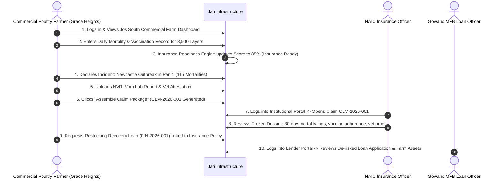

# 48-HOUR MVP SCOPE SPECIFICATION
**Project**: Commercial Poultry Insurance & Finance Infrastructure (Jari)  
**Hackathon**: HackJos 2026 (48-Hour Deadline)  
**Initial Market**: Jos South LGA, Plateau State, Nigeria  
**Target Segment**: Commercial Poultry Farms (Focus: >2,000 birds)  
**Status**: APPROVED ROADMAP (V1.0)

---

## 1. THE 48-HOUR MISSION & OBJECTIVE

In 48 hours, our goal is **NOT** to build a hollow app with dozens of shallow, non-working screens.  
Our objective is to deliver a **cohesive, verifiable, end-to-end operational workflow** that proves the core thesis:

> *"Organized digital farm records, biosecurity compliance, and immutable operational logs make commercial poultry farms easier to insure, faster to document for claims, and credible to assess for agricultural finance."*

---

## 2. TRIAGED FEATURE TIERS

```
+-----------------------------------------------------------------------------------------+
| [TIER A] ESSENTIAL FOR HACKATHON DEMO (Must-Have 48-Hour Workflow)                      |
| 1. Commercial Farm Registration (Jos South geo-parameters, pens, infrastructure)        |
| 2. Poultry-House & Flock Batch Creation (>2,000 bird scale: Layers & Broilers)           |
| 3. Operational Daily Logs (Daily mortality log, egg production, vaccination compliance) |
| 4. Insurance Readiness Engine (Calculated readiness score, biosecurity checklist)       |
| 5. Incident Outbreak Declaration (Immediate disease reporting, mortality count)         |
| 6. Claims Evidence Package Assembly (1-click generation of structured claims dossier)   |
| 7. Farm Financial Profile & Credit Readiness (Bird asset valuation, operating margin)   |
| 8. Financing Application Preparation (De-risked loan application for Gowans MFB/BOA)    |
| 9. Institutional Underwriter Portal (Review claim dossier, inspect mortality logs)      |
| 10. Institutional Lender Portal (Review loan application, verify active insurance)      |
+-----------------------------------------------------------------------------------------+
| [TIER B] IMPORTANT IF TIME PERMITS (Secondary Polish)                                   |
| - PDF / Print export of Compiled Claims Dossier & Loan Application Pack                 |
| - SMS / WhatsApp notification simulation for daily mortality reminders                  |
| - Feed conversion ratio (FCR) auto-calculation for Broiler flocks                      |
| - Multi-house interactive bird density visualization                                    |
| - Filterable institutional audit activity log                                           |
+-----------------------------------------------------------------------------------------+
| [TIER C] FUTURE ROADMAP (Post-HackJos Commercialization)                                |
| - Direct API integration with NAICOM portal under 2025 Insurtech Guidelines             |
| - Core banking integration with NIBSS / commercial core banking APIs                    |
| - Automated IoT sensor integration for poultry house ammonia and temperature            |
| - Expansion into additional LGAs in Plateau (Jos North, Bassa, Mangu) and other states  |
| - Commercial satellite / GIS vegetation and flood hazard risk overlay                   |
+-----------------------------------------------------------------------------------------+
```

---

## 3. THE GOLDEN DEMONSTRATION FLOW (END-TO-END)

The live 3-minute hackathon pitch will showcase the following connected journey:



---

## 4. SIMULATED DEMONSTRATION DATA SPECIFICATION

To ensure data credibility before agricultural judges and institutional partners, all demo entities reflect realistic poultry parameters in Jos South:

### 4.1 Demo Farm Profile
- **Farm Name**: *Grace Heights Integrated Poultry Farms*
- **Location**: Along Zawan Road, Gyel District, Jos South LGA, Plateau State
- **Established**: 2021 | **Capacity**: 7,500 birds across 3 houses
- **Water Source**: Dedicated Industrial Borehole | **Power**: 10kVA Solar Hybrid + Generator
- **Assigned Vet**: Dr. Pam Gyang, DVM (VCN Number: `VCN-4421`, Plateau State Ministry of Agriculture / Private Vet Consultant)

### 4.2 Active Demo Flocks
1. **Flock A**: 
   - Code: `FLK-2026-001` | House: Pen 1 (Deep Litter)
   - Type: **Isa Brown Layers** (3,500 birds stocked at Day 1, current age: 24 weeks / Day 168)
   - Egg Production: 92 crates/day (88% lay rate)
   - Vaccination History: Marek's (Hatchery), Newcastle Lasota (Day 7, 21), Gumboro (Day 14, 28), Fowl Pox (Week 6), EDS (Week 16) - **100% compliant**.
2. **Flock B**:
   - Code: `FLK-2026-002` | House: Pen 2
   - Type: **Cobb 500 Broilers** (2,000 birds stocked, current age: 4 weeks / Day 28)
   - Average weight: 1.45 kg.

### 4.3 Demo Incident & Claim
- **Incident Code**: `INC-2026-004`
- **Occurrence**: Sudden virulent Newcastle Disease flare-up following extreme cold harmattan winds in Jos South.
- **Mortality**: 115 dead birds in 24 hours.
- **Claim Reference**: `CLM-2026-001`
- **Claim Amount**: ₦850,000 (Valuation of dead point-of-lay layers + feed sunk cost).
- **Evidence Attached**:
  1. NVRI Vom Lab Pathology Preliminary Report (`lab_nvri_rep_9901.pdf`).
  2. Post-mortem clinical diagnosis signed by Dr. Pam Gyang (`vet_attest_gyang.pdf`).
  3. Geo-tagged photo of deep burial pit with lime treatment (`carcass_disposal_01.jpg`).

### 4.4 Demo Financial Profile & Loan Application
- **Annual Turnover**: ₦24,500,000.00
- **Live Flock Asset Valuation**: ₦12,250,000.00 (3,500 layers @ ₦3,500 salvage value)
- **Finance Readiness Score**: 78 / 100
- **Loan Reference**: `FIN-2026-001`
- **Target Lender**: *Gowans Microfinance Bank* (Prospective Local Pilot)
- **Requested Amount**: ₦3,500,000.00 (Restocking + 60-day feed buffer)
- **De-risking Factor**: Active NAIC Poultry Mortality Policy attached (`POL-NAIC-2026-088`).

---

## 5. BUSINESS & REGULATORY SAFEGUARDS

1. **Prospective Partner Labeling**:
   - The UI and documentation must clearly state: *"Nigerian Agricultural Insurance Corporation (NAIC), AIICO, Leadway, Gowans Microfinance Bank, BOA, and NIRSAL Plc are prospective pilot partners."*
   - Never display them as contractual or confirmed clients during the hackathon.
2. **Regulatory Positioning**:
   - In accordance with NAICOM Insurtech Guidelines (August 2025), the platform acts strictly as a **technology documentation and workflow infrastructure provider**.
   - Underwriting decisions, risk inspections, policy terms, and claims payments are the exclusive prerogative of licensed underwriters.
   - Credit assessment, collateral verification, and lending disbursements are the exclusive prerogative of licensed financial institutions.

